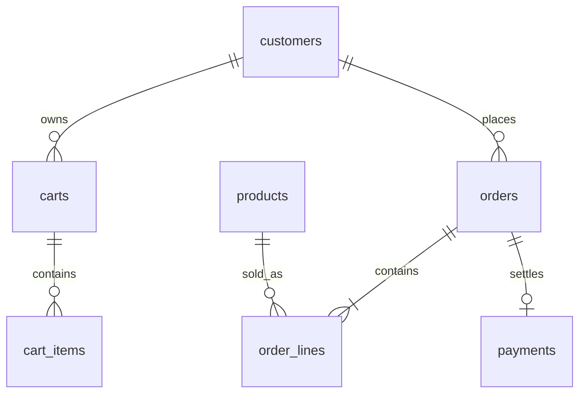

# Capstone 01 — Webshop

> **English** · [Srpski](README.sr.md)

Build a bookstore webshop where a checkout creates an order, preserves historical price, reserves stock, and can safely survive a client retry.

## Deliverables

1. Apply the [starter schema](schema.postgresql.sql) through a migration tool.
2. Write `checkout(customer_id, idempotency_key)` as a transaction: lock/validate stock, copy current price to line items, decrement stock, create the order, and clear the cart.
3. Add a payment callback that can be retried without charging or changing the same order twice.
4. Create: customer order history, low-stock report, and monthly recognized-revenue report.

## Rules and acceptance criteria

- Never calculate historical revenue from the current `products.price_cents`.
- A unique idempotency key must return the existing checkout result on retry.
- A failed checkout leaves stock, cart, and order state unchanged.
- Out-of-stock behavior is deterministic under concurrent requests.
- Explain the index supporting customer order history and the index supporting low-stock monitoring.

At 100× scale, discuss an outbox for payment events, a separate search index, and inventory reservation expiry.
