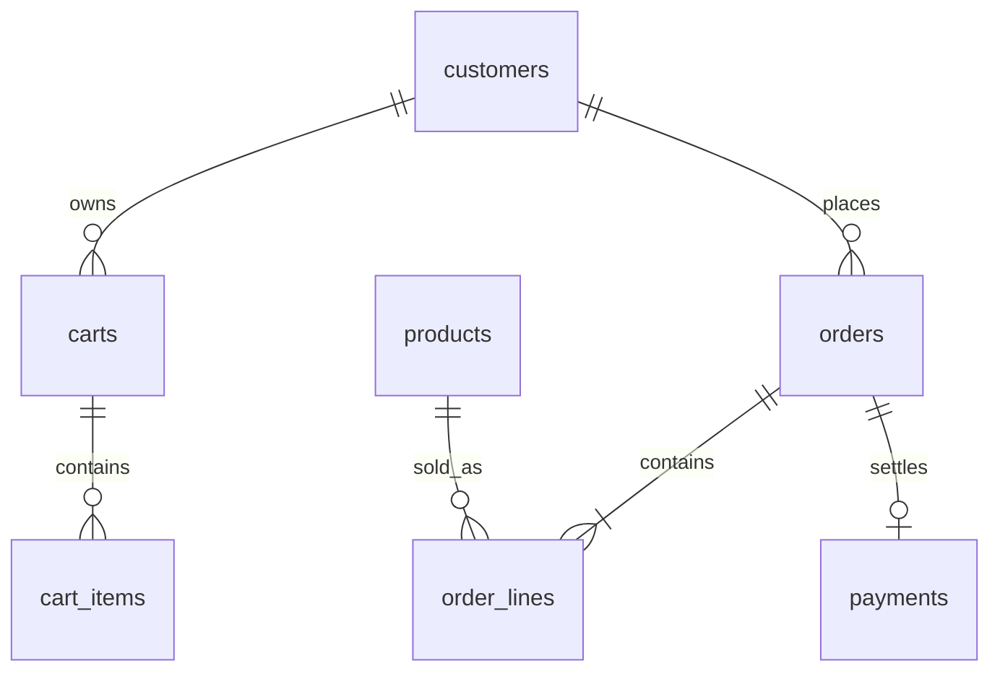

# Projekat 01 — Webshop

> **Srpski** · [English](README.md)

Napravi knjižarski webshop gde checkout pravi narudžbinu, čuva istorijsku cenu, rezerviše zalihu i bezbedno preživljava ponovljeni zahtev klijenta.

## Isporuke

1. Primeni [početnu šemu](schema.postgresql.sql) kroz alat za migracije.
2. Napiši `checkout(customer_id, idempotency_key)` kao transakciju: zaključaj/proveri zalihu, kopiraj cenu u stavke, umanji zalihu, napravi narudžbinu i isprazni korpu.
3. Dodaj payment callback koji može biti ponovljen bez duplog terećenja ili promene iste narudžbine.
4. Napravi pregled istorije kupca, low-stock izveštaj i mesečni recognized revenue.

## Pravila i kriterijumi

- Istorijski prihod se nikada ne računa iz trenutne `products.price_cents`.
- Jedinstven idempotency ključ pri ponavljanju vraća postojeći rezultat checkout-a.
- Neuspešan checkout ne menja zalihu, korpu ni narudžbinu.
- Ponašanje kada nema zalihe je determinističko i pod paralelnim zahtevima.
- Objasni indeks za istoriju narudžbina kupca i indeks za praćenje male zalihe.

Na 100× razmisli o outbox-u za događaje plaćanja, odvojenom search indeksu i isteku rezervacije zalihe.
