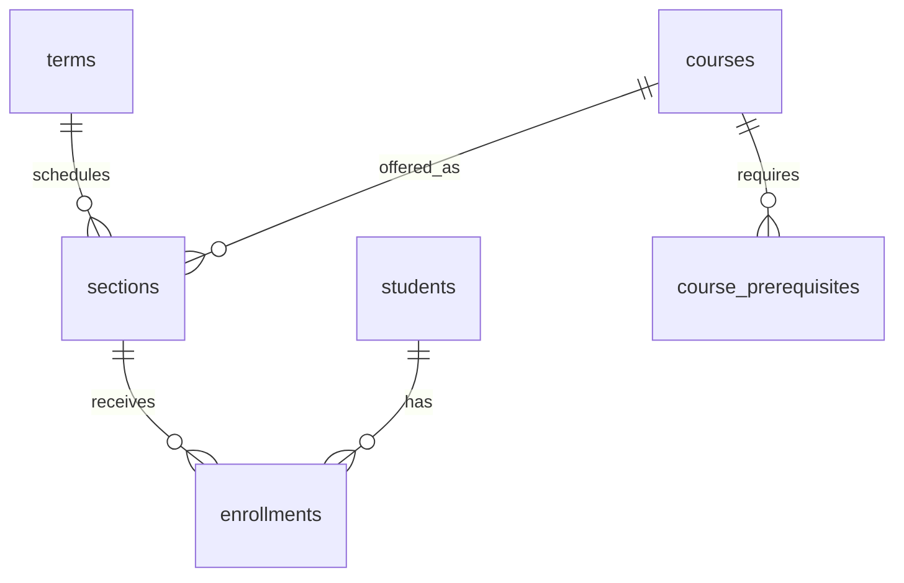

# Capstone 02 — University Enrollment

> **English** · [Srpski](README.sr.md)

Build an academic system that models courses, terms, sections, prerequisites, enrollment capacity, and final grades without allowing invalid enrollment.

## Deliverables

1. Apply the [starter schema](schema.postgresql.sql).
2. Implement enrollment as one transaction that checks capacity, duplicates, term state, and prerequisites.
3. Create reports for student transcript, section fill rate, and students at risk because of failed prerequisites.
4. Design RLS so a student reads only their own enrollments while staff gain role-specific access.

## Acceptance criteria

- A student cannot enroll twice in the same section.
- A closed/full section does not oversubscribe under concurrent requests.
- Grade history is auditable; do not overwrite a prior value silently.
- Explain the index for a student's transcript and the index for capacity lookup.
