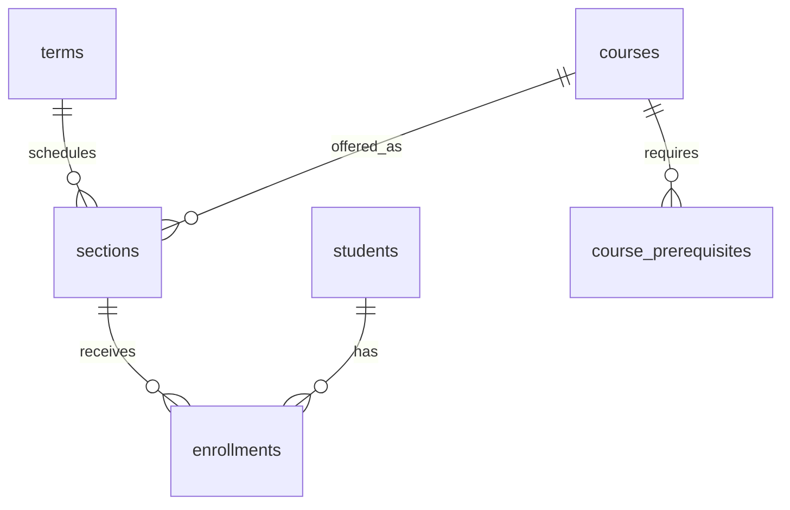

# Projekat 02 — Univerzitetski upis

> **Srpski** · [English](README.md)

Napravi akademski sistem koji modeluje predmete, semestre, grupe, preduslove, kapacitet upisa i konačne ocene bez mogućnosti nevalidnog upisa.

## Isporuke

1. Primeni [početnu šemu](schema.postgresql.sql).
2. Upis realizuj jednom transakcijom koja proverava kapacitet, duplikat, stanje semestra i preduslove.
3. Napravi transcript studenta, popunjenost grupa i izveštaj o studentima sa neuspešnim preduslovima.
4. Dizajniraj RLS: student čita samo svoje upise, a osoblje ima prava po roli.

## Kriterijumi

- Student ne može dva puta u istu grupu.
- Zatvorena/puna grupa se ne prepisuje ni pod paralelnim zahtevima.
- Istorija ocena je proverljiva; stara vrednost se ne pregazi tiho.
- Objasni indeks za transcript i indeks za proveru kapaciteta.
