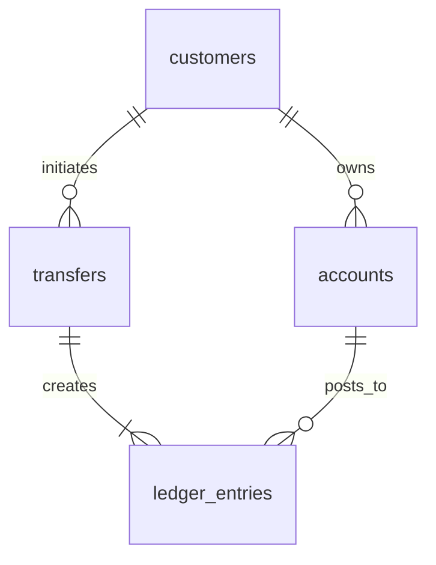

# Capstone 03 — Banking Ledger

> **English** · [Srpski](README.sr.md)

Build a ledger service for transfers between accounts. The core objective is not a balance column; it is an immutable, balanced record of every monetary movement.

## Deliverables

1. Apply the [starter schema](schema.postgresql.sql).
2. Implement `create_transfer(from_account, to_account, amount_cents, idempotency_key)` in one transaction.
3. Create exactly two immutable ledger entries for every completed transfer: debit and credit.
4. Build account statement, daily net-flow, and reconciliation reports.

## Non-negotiable invariants

- `amount_cents` is positive; use integer minor units, never floating point.
- Every completed transfer has equal total debit and credit. A missing or duplicate leg is a data incident.
- Entries are append-only. Corrections use reversing entries, never `UPDATE` or `DELETE` on posted history.
- The same idempotency key cannot create a second transfer.
- Lock accounts in a deterministic ID order or use an appropriate concurrency strategy to avoid deadlocks.

At 100× scale, discuss partitioning immutable history, audit retention, asynchronous fraud review, and reconciliation against an external payment rail.
