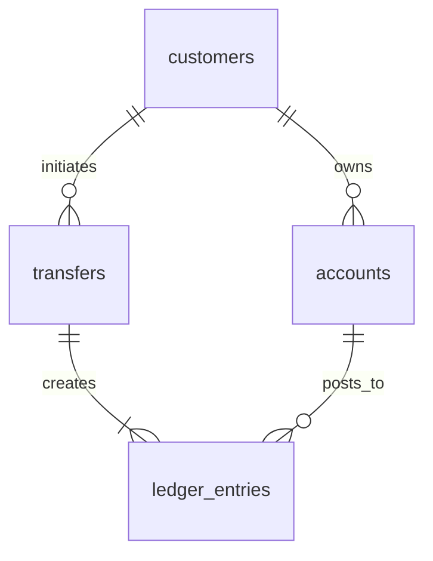

# Projekat 03 — Bankarski ledger

> **Srpski** · [English](README.md)

Napravi ledger servis za transfere između računa. Glavni cilj nije jedna kolona za stanje, već nepromenljiv i uravnotežen zapis svakog pomeranja novca.

## Isporuke

1. Primeni [početnu šemu](schema.postgresql.sql).
2. Implementiraj `create_transfer(from_account, to_account, amount_cents, idempotency_key)` u jednoj transakciji.
3. Za svaki završen transfer napravi tačno dve nepromenljive stavke: debit i credit.
4. Napravi account statement, dnevni net-flow i reconciliation izveštaj.

## Pravila bez izuzetka

- `amount_cents` je pozitivan; koristi celobrojne manje jedinice, nikada floating point.
- Svaki završen transfer ima jednak zbir debita i kredita. Nedostajuća ili duplirana strana je incident s podacima.
- Stavke su append-only. Ispravka ide reversing stavkom, nikada `UPDATE` ili `DELETE` nad objavljenom istorijom.
- Isti idempotency ključ ne može napraviti drugi transfer.
- Račune zaključavaj determinističkim redom po ID-ju ili koristi odgovarajuću konkurentnu strategiju protiv deadlock-a.

Na 100× razmisli o particionisanju nepromenljive istorije, čuvanju audita, asinhronoj fraud proveri i reconciliation-u prema spoljnom payment sistemu.
