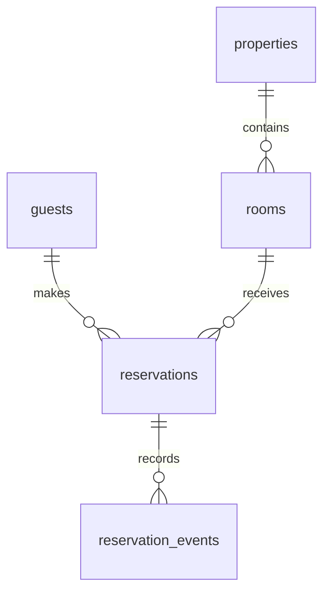

# Capstone 04 — Booking and Availability

> **English** · [Srpski](README.sr.md)

Build a reservation system for properties and rooms. The hard problem is not saving dates; it is preventing overlapping confirmed reservations under concurrent requests.

## Deliverables

1. Apply the [starter schema](schema.postgresql.sql), including its range and exclusion constraint.
2. Implement availability search for a requested date range and capacity.
3. Create a booking flow that returns a clear conflict when another request reserves the same room first.
4. Add cancellation, audit events, nightly occupancy, and revenue-by-property reports.

## Acceptance criteria

- A confirmed reservation can never overlap another confirmed reservation for the same room.
- A cancelled reservation releases availability without deleting history.
- The requested end date is exclusive: `[check_in, check_out)` avoids ambiguity at back-to-back stays.
- Availability search and the exclusion constraint use compatible range logic.
- Explain why application-side “check, then insert” alone is not safe under concurrency.

At 100× scale, discuss partitioning reservation history, read models for search, calendar synchronization, and regional time-zone rules.
