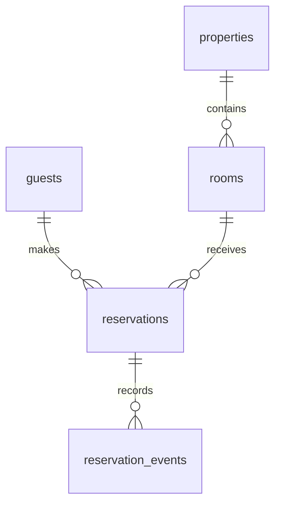

# Projekat 04 — Rezervacije i dostupnost

> **Srpski** · [English](README.md)

Napravi sistem rezervacija za objekte i sobe. Težak deo nije čuvanje datuma, već sprečavanje preklapanja potvrđenih rezervacija pod paralelnim zahtevima.

## Isporuke

1. Primeni [početnu šemu](schema.postgresql.sql), sa range i exclusion ograničenjem.
2. Implementiraj pretragu dostupnosti za opseg datuma i kapacitet.
3. Napravi booking tok koji vraća jasan konflikt kada drugi zahtev prvi rezerviše istu sobu.
4. Dodaj otkazivanje, audit događaje, noćnu popunjenost i prihod po objektu.

## Kriterijumi

- Potvrđena rezervacija se nikad ne preklapa sa drugom potvrđenom rezervacijom iste sobe.
- Otkazana rezervacija oslobađa dostupnost bez brisanja istorije.
- Datum odlaska je ekskluzivan: `[check_in, check_out)` uklanja dilemu kod rezervacija koje se nadovezuju.
- Pretraga dostupnosti i exclusion ograničenje koriste kompatibilnu range logiku.
- Objasni zašto aplikacioni „proveri, pa upiši” sam po sebi nije bezbedan pod konkurentnim zahtevima.

Na 100× razmisli o particionisanju istorije, read modelima za pretragu, sinhronizaciji kalendara i pravilima vremenskih zona po regionima.
