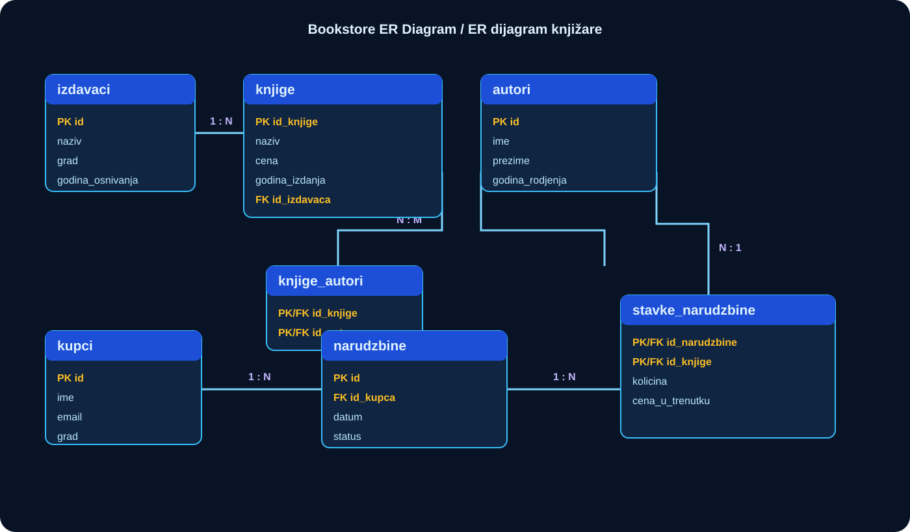

# ER Diagrams

> **English** · [Srpski](README.sr.md)

Diagrams make relationship cardinality visible before code is written. Treat them as design artifacts: update the diagram in the same pull request as the migration that changes the relationship.

## Bookstore foundation model

| Relationship | Meaning |
| --- | --- |
| publisher → books | one publisher can issue many books |
| books ↔ authors | many-to-many through `knjige_autori` |
| customer → orders | one customer can place many orders |
| orders ↔ books | many-to-many through `stavke_narudzbine`, which stores quantity and historical price |

For the capstone diagrams, see the project briefs in [Webshop](../capstones/01-webshop/README.md), [University](../capstones/02-university/README.md), [Banking](../capstones/03-banking-ledger/README.md), and [Booking](../capstones/04-booking/README.md). They use Mermaid ER code so the relationship model stays versionable alongside the text.
