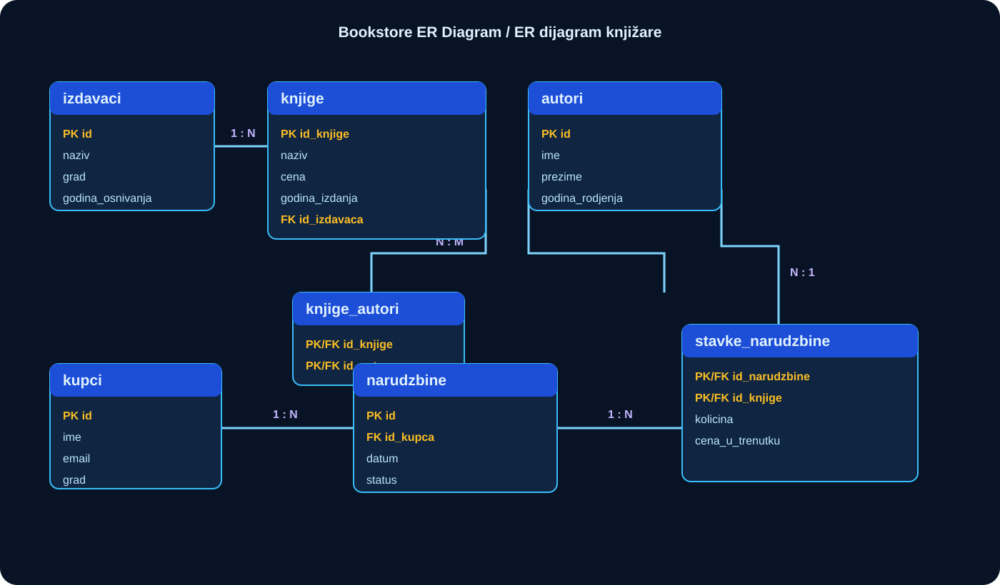

# ER dijagrami

> **Srpski** · [English](README.md)

Dijagram čini kardinalnost veze vidljivom pre pisanja koda. Tretiraj ga kao dizajnerski artefakt: ažuriraj ga u istom pull request-u kao i migraciju koja menja odnos.

## Osnovni model knjižare

| Veza | Značenje |
| --- | --- |
| izdavač → knjige | jedan izdavač može objaviti više knjiga |
| knjige ↔ autori | više-prema-više kroz `knjige_autori` |
| kupac → narudžbine | jedan kupac može imati više narudžbina |
| narudžbine ↔ knjige | više-prema-više kroz `stavke_narudzbine`, gde žive količina i istorijska cena |

ER dijagrame za velike projekte pogledaj u brief-ovima: [Webshop](../capstones/01-webshop/README.sr.md), [Univerzitet](../capstones/02-university/README.sr.md), [Banking](../capstones/03-banking-ledger/README.sr.md) i [Rezervacije](../capstones/04-booking/README.sr.md). Koriste Mermaid ER kod da model ostane verzionisan uz tekst.
